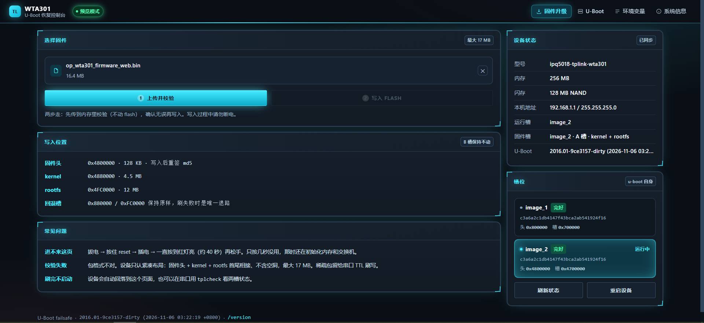

# WTA301 u-boot kit —— 源码复现包

> 目标：不拷源码树、不拷工具链，只用本仓 + 上游固定引用，重建出
> `u-boot.bin`（556,032 B）→ LZMA 槽镜像（262,144 B）。
>
> **本仓 = 全部自研代码**。23 个文件 / 13,063 行 / 385 KB。除此之外没有任何
> 改动，基座一律从上游取。
>
> 上位工程是 **`wta301-2512`**（OpenWrt 25.12.6 移植仓），
> 本仓是其 u-boot 部分的独立发布版；内容与那边 `patches/uboot/` 一致。



↑ `files/failsafe/fsdata/index.html` 渲染出来的网页恢复控制台：U-Boot 版本、
板型/内存/NAND、网络参数、`boot_flag`、两个槽的校验状态，以及固件上传入口。

> ⚠️ 这张图是**预览模式**截的 —— 页面检测到 `file://` 协议就走内建 mock 数据
> （`index.html` 的 `var PREVIEW = (location.protocol === "file:")` 与 `var MOCK`），
> 所以里面的 `image_2 active`、`boot_flag raw:2`、两槽相同 md5 都是**示例值**，
> 不是某台具体板子的真实状态。真机状态下这些字段由 `/sysinfo`、`/sysinfo/tplink`
> 从 NAND 实读。

---

## 1. 上游基座（tree 不进仓库）

| 项 | 值 | 出处 |
|---|---|---|
| u-boot 源码 | `u-boot-2016`，分支 **`NHSS.QSDK.12.5`** | `https://git.codelinaro.org/clo/qsdk/oss/boot/u-boot-2016` |
| 对应的 QSDK 发布标签 | `AU_LINUX_QSDK_NHSS.QSDK.12.5_TARGET_ALL.12.5.2783.2994` | 同上 |
| 公开镜像（不用登录 codelinaro 就能取） | `1980490718/u-boot-2016`（GPL-2.0，README 明写 “Stripped from `AU_LINUX_QSDK_NHSS.QSDK.12.5_TARGET_ALL.12.5.2783.2994`”） | `https://github.com/1980490718/u-boot-2016` |
| 构建包装 + failsafe 框架 | `chenxin527/uboot-qsdk12.5-build`（**GPL-2.0**） | `https://github.com/chenxin527/uboot-qsdk12.5-build` |
| 本机构建时该包装的 HEAD | **`9ce31573`** “Merge pull request #4 from webbrain-one/webbrain/readme-improvement” | 见下方铁证 |
| 工具链 | `arm_cortex-a7_gcc-5.2.0_musl-1.1.16_eabi`（`arm-openwrt-linux-muslgnueabi-`） | OpenWrt 25.12.6 staging_dir |

### 1.1 构建包装 commit 是硬证，不是回忆

已经交付的 `u-boot.bin`（556,032 B）里面直接带着版本横幅：

```
$ strings u-boot.bin | grep '^U-Boot 2016'
U-Boot 2016.01-9ce3157-dirty (2026-11-06 13:33:07 +0800)
              ↑↑↑↑↑↑↑
```

`9ce3157` 就是 `9ce31573` 的缩写，`-dirty` 是因为叠加了本目录 `files/` 的改动。
⇒ **构建包装确实钉在 `9ce31573`，已由产物自证。**

### 1.2 残余风险：codelinaro 侧的 commit

**codelinaro 裸树没有固定 commit**，我们当时也没记。但风险被两层兑掉了：

1. **有发布标签可对**：`NHSS.QSDK.12.5` 分支对应 `AU_LINUX_QSDK_NHSS.QSDK.12.5_
   TARGET_ALL.12.5.2783.2994`，同代基座只有这一个发布点；
2. **有公开镜像可拿**：`1980490718/u-boot-2016`，不用登录 codelinaro；
3. **overlay 而不是 diff**：本目录 `files/` 是**整份文件全量收录**，
   只要基座是同一代（2016.01 / QSDK 12.5），覆盖后结果就对；
   diff 才需要逐字节精确的基座。

⚠️ **未验证的事**：本机原树与上面那个 GitHub 镜像**是否逐字节相同，没对过**。
镜像自称剥自同一个发布标签，但只有亲自跑一遍编译、对出 `u-boot.bin` 556,032 B
才算实证。**目前只到「同代」这个级别，未到「同一棵树」。**

### 1.3 为什么旧读还会跑偏

- `/root/ow2512` 里没有任何 u-boot 源码，**这里就是唯一入口**；
- 别用 `src/.git` 找包装版本 —— `src/u-boot-2016/` 已无 `.git`（纯文件树），
  能查的只有二进制里的版本横幅（§1.1）。

---

## 2. 目录

```
wta301-uboot-kit/
├── README.md           本文件
├── CHANGES.md          逐文件修改声明（GPL-2.0 §2(a)），23 个文件每个一行
├── THIRD-PARTY.md      上游归属（4 个版权方 / 缺头文件 / 可开源评估）
├── LICENSE             GPL-2.0
├── verify-kit.sh       本仓自检（23 文件在位 / 版权头 / 编码 / 无个人路径 / 常量）
├── files/              ★ 当前有效代码（23 个文件，按 u-boot 树内相对路径）
├── build/              构建脚本
│   ├── build_board.sh     官方流程（make defconfig → 清 DTB → make -j6）
│   ├── build_j1.sh        ★ 推荐入口（-j1 串行，见 §4 的坑，跑完自动出槽镜像）
│   ├── build_wta301.sh    LEGACY：当时跑的 `make -j6` 原样记录，只为追溯
│   └── mk_uboot_slot.py   u-boot.bin → 256 KB LZMA 槽镜像（带往返校验）
├── p18/ p19/ p20/ p21/   历史快照（**不要直接用，见 §5**）
├── ub_01_*.dts …         从低版本 u-boot 提取的 DTS 参考（逆向证据）
└── .._048xxx.dts
```

### files/ 内容（23 个）

| 文件 | 行数 | 改了什么 |
|---|---|---|
| `drivers/net/ipq5018/rtl8367s.c` | 540 | **RTL8367S 交换机驱动**（有线通的核心） |
| `board/qca/arm/ipq5018/ipq5018.c` | 2,283 | 板级初始化 |
| `arch/arm/cpu/armv7/qca/common/smem.c` | 1,332 | SMEM / 分区 |
| `board/qca/arm/common/cmd_bootqca.c` | — | 启动命令 |
| `board/qca/arm/common/ethaddr.c` | 300 | MAC 地址 |
| `board/qca/arm/common/failsafe.c` | — | 按键触发的恢复模式 |
| `board/qca/arm/common/fw_dec.c` | — | 固件解密/头解析 |
| `board/qca/arm/common/tplink_tpimg.c` | — | **TP-Link 镜像格式 + 双槽写入** |
| `drivers/net/ipq5018/ipq5018_gmac.c` | — | GMAC |
| `drivers/net/Makefile` | — | 把 `rtl8367s.o` 编进去 |
| `failsafe/failsafe.c` | — | failsafe 主循环（`FAILSAFE_IDLE_MS_NOCLIENT` 180 s） |
| `failsafe/fsdata/index.html` | — | 网页 UI（赛博机械 HC-3），makefsdata 会 gzip 嵌入 |
| `failsafe/modules/{Makefile,modules.h,tplinkinfo.c,upgrade.c}` | — | `/sysinfo/tplink`、`/upload`、`/result` |
| `include/configs/ipq5018.h` | — | `MALLOC_LEN` 2 MB（P21 关键修复）、`TPIMG_*` 常量 |
| `include/failsafe/{fw_dec.h,tplink_tpimg.h}` | — | 头文件 |
| `configs/ipq5018_tplink_wta301_defconfig` | 359 | **板级 defconfig，缺它连 make defconfig 都跑不了** |
| `arch/arm/dts/{Makefile,ipq5018-tplink-wta301.dts}` | 493 / — | DTS 注册与本体 |
| `board/ipq5018/Kconfig` | 104 | 板型注册 |

---

## 3. 复现步骤

```bash
# 1) 取基座（放在 $SRC，例如 /root/ub）
git clone https://github.com/chenxin527/uboot-qsdk12.5-build.git
#    自带 staging_dir 工具链；u-boot-2016/ 源码按该项目 README 从 codelinaro 取
#    分支 NHSS.QSDK.12.5

# 2) 铺我们的代码（全量覆盖，无需打补丁）
cp -a files/. $SRC/u-boot-2016/

# 3) 编
cd $SRC
export ARCH=arm CROSS_COMPILE=arm-openwrt-linux-muslgnueabi-
export STAGING_DIR=$PWD/staging_dir
export PATH=$PWD/staging_dir/toolchain-arm_cortex-a7_gcc-5.2.0_musl-1.1.16_eabi/bin:$PATH
cd u-boot-2016
make ipq5018_tplink_wta301_defconfig
rm -f arch/arm/dts/ipq5018-tplink-wta301.dtb.comb.o \
      arch/arm/dts/.ipq5018-tplink-wta301.dtb.comb.o.cmd \
      arch/arm/dts/dtbtable.S arch/arm/dts/dtb_combined.bin
make -j1                     # ← 必须串行，见 §4

# 4) 出槽镜像
python build/mk_uboot_slot.py u-boot.bin <输出目录>
```

### 验收判据（P21c）

| 项 | 期望 |
|---|---|
| `u-boot.bin` | **556,032 B** |
| `u-boot.bin` md5 | `3a4cb00e37065936e5ff89cb5710a519` |
| 槽镜像 | 262,144 B |
| 槽 md5 | **`d0ada9f76e4f1aba9b96a559a5220cee`** |
| 槽 crc32 | `0xCB2D3108` |
| 槽内 LZMA 解压后 | 逐字节等于 `u-boot.bin` |
| 板上 `tplcheck` | 两槽 `OK (md5 matches, decodes to 0x87c00)` |

### 验证边界（哪一步实测过、哪一步没有）

诚实分开写，不要当成全都跑过：

| 环节 | 状态 | 证据 |
|---|---|---|
| `files/` 覆盖后与当前源树一致 | ✅ **已实证** | 23/23 内容相同。其中 4 个逐字节相同，19 个仅差**末尾换行**（仓库侧按 POSIX 习惯补了换行）。**无任何内容差异**。末尾换行在 `.c/.h/Makefile/.dts` 里不影响编译产物；唯一会被逐字节嵌入的 `index.html` 两侧都已有末尾换行。 |
| `mk_uboot_slot.py` 能重出槽镜像 | ✅ **已实证（复验两次）** | 上游 OpenWrt 仓（`wta301-2512`）的 `deliver/make-deliverable.sh` 已接入：只要找到 556,032 B 的 `u-boot.bin` 就现造槽镜像，再造不出来才回落历史成品 |
| 输入 `u-boot.bin` 指纹 | ✅ **已核对** | `src/u-boot-2016/u-boot.bin` 556,032 B / md5 `3a4cb00e37065936e5ff89cb5710a519`，与 §3 判据逐字相同 |
| `u-boot.bin` → 槽镜像（端到端） | ✅ **已实证** | `mk_uboot_slot.py u-boot.bin` → 262,144 B / md5 `d0ada9f7…` / crc32 `0xCB2D3108`，往返校验通过（解压后与 `u-boot.bin` 逐字节相等） |
| `build_j1.sh` 从零跑一遍出 `u-boot.bin` | ⬜ **未实跑** | 脚本已参数化（`UBOOT_TREE` / `TOOLCHAIN_BIN` 环境变量），**未在本轮执行**。已按用户指示跳过，不为它再开一轮编译。 |
| 跨机器全链路（新基座 + 本 overlay → 同 md5） | ⬜ **未验证** | 受 §1.1 基座 commit 未固定所限，本就不可能保证 |

> **读法**：从 `u-boot.bin` 到可刷槽镜像是**完全闭环**的（逐字节对过板子上的实物，本轮又复验一次）。
> 唯一的缺口是上一级：**从基座源码编出那个 `u-boot.bin`** —— 脚本已参数化但未实跑，
> 而且基座 commit 未固定，跨机器首次成功也不能指望 md5 一致。
> 真要卡死复现，唯一办法是把 codelinaro 基座的 commit 钉下来并写进 §1.1。

---

## 4. 四个必须知道的坑

### 4.1 `make -j1` 必须串行

`arch/arm/dts/dtbtable.S` 是**构建的副作用**（由 dtb_combined.bin 生成），
并行时会先被别的目标依赖到、还不存在 ⇒ 报 `dtbtable.S: No such file`。
处理：**再跑一次**即可（或者干脆用 `-j1`）。耗时 ~150–235 s。

### 4.2 绝不能 `make distclean` / `mrproper`

会删掉手写的 `arch/arm/dts/ipq5018-tplink-wta301.dts`。
`build_wta301.sh` 里那句注释就是为此。

### 4.3 一级 u-boot 的硬约束（违反 = TTL 直接死）

一级（`factory_boot`，`0x0-0x3c0000`）不是 U-Boot，它对二级槽只有三步：
读 `0x4700000` 起 **`0x40000`** 字节 → **LZMA 解压上限 `0xa0000`** →
`blx` 到 **`0x49900000`**。

| 约束 | 违反后果 |
|---|---|
| 槽内容必须是 LZMA-Alone 流 | 一级**没有裸镜像回退**，解压失败照样 `blx` 跳进垃圾 → 静默死 |
| 链接基址必须是 `0x49900000` | 链在 `0x4a920000` → **TTL 直接死** |
| 未压缩 ≤ `0xa0000` (640 KB) | 解压越界截断 |
| 槽 ≤ `0x40000` (256 KB) | 一级只读 256 KB，多出来是垃圾 |

`0x4a920000` 是一级**自己运行**的地址，往那儿试跑 = 覆盖正在运行的一级。
**只往 `0x49900000` 试。**

### 4.4 槽大小两条余量（P19 量化）

| 约束 | 上限 | 556,032 产物对应 | 余量 |
|---|---|---|---|
| 压缩后进槽 `TPIMG_UBOOT_SLOT_LEN` | 262,144 B | 218,280 B | 43,864 B (17%) |
| 一级解压缓冲 `TPIMG_UBOOT_DEC_CAP` | 655,360 B | 556,032 B | 99,328 B (15%) |

先撞的是**解压后 655,360 B**。加功能前先看这条。

---

## 5. ⚠️ p18/p19/p20/p21 的陷阱（历史快照，不要直接用）

历史目录**同名文件内容不同**，且命名方式不统一：

| 目录 | 命名 | 内容 |
|---|---|---|
| `p18/` | **扁平**（`board_qca_arm_common_failsafe.c`） | dts / failsafe.c / fw_dec.c / fw_dec.h 是**当前版**；`tplink_tpimg.*` 是**旧版** |
| `p19/` | 原名 | 旧版 |
| `p20/` | 原名（`failsafe.c`） | `failsafe.c` 是**旧版**（p18 那份才是当前版）；`modules/*` 除 `tplinkinfo.c` 外是当前版 |
| `p21/` | 原名 | 5 个文件是当前版 |

照 p20 取 `failsafe.c` 就会装错。**一律以 `files/` 为准**，历史目录只用于追溯。

命名不一致是早期交付的遗留问题，保持原样不改（改了就对不上 `docs/` 里的旧记录）。

---

## 6. 刷写（两条路，都不用 TTL）

| 方法 | 说明 | 耗时 |
|---|---|---|
| 网页 | `http://192.168.1.1` → U-Boot 页 → 选槽镜像 → 上传并校验 → 写入 | ~2 s |
| 串口 | `tftpboot` → `crc32` → 写槽 → 读头 → 只改 `+0x90` 4 个 `mw.l` → 写头 → 回读核对 | ~6 s |

**写入顺序永远是「先写槽、后改头」**：中途断电时头里 `+0x90` 的 md5 还是旧的
→ 一级判定该槽损坏 → 自动降另一个槽 → 砖不了。

`/result` 必须**空 body**：`net/httpd.c:549` 收到带 `Content-Type` 却没有
`boundary` 的 POST 直接回 400（浏览器给字符串 body 会自动加
`text/plain;charset=UTF-8`，正好踩中）。见 `docs/P20-UBOOT-UI.md` §11。
